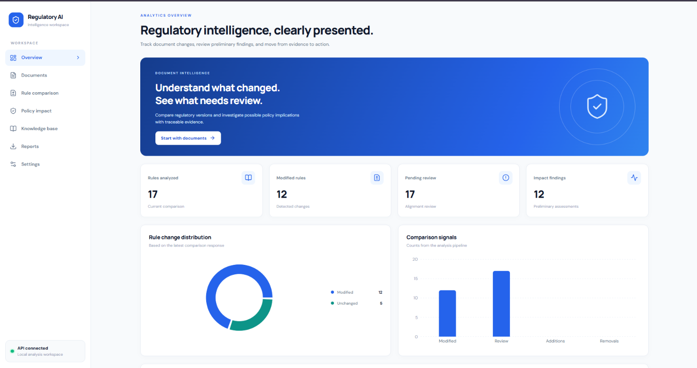
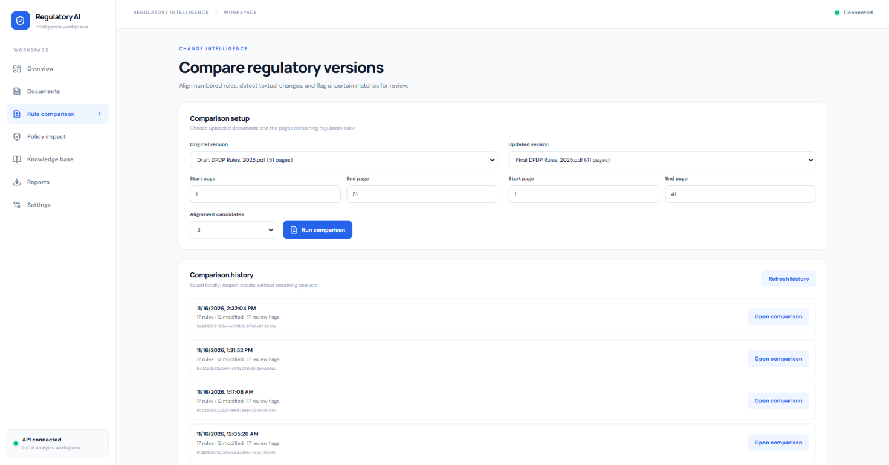
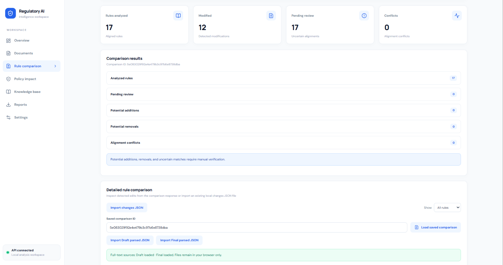
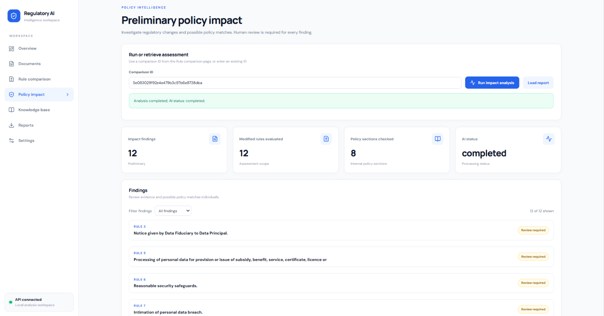
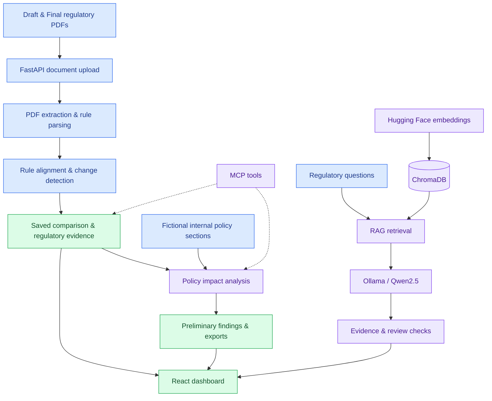

<div align="center">

# ⚖️ Regulatory AI Intelligence System

### Regulatory change detection · Evidence-grounded RAG · AI-assisted policy impact

A **local-first AI application** for comparing versions of structured regulations, identifying rule changes, and exploring their potential impact on internal company policies.

**Case study:** India's **Draft and Final DPDP Rules, 2025**, assessed against a fictional organization's policy sections.


**[Features](#-key-features) · [Architecture](#-system-architecture) · [Tech Stack](#-technology-stack) · [Getting Started](#-getting-started) · [Testing](#-testing)**

</div>

---

## ✨ Project at a glance

| 📄 Regulatory intelligence | 🧠 Local AI & retrieval | 🛡️ Evidence & review |
|:---|:---|:---|
| PDF extraction, numbered-rule parsing, version alignment, change detection | Hugging Face sentence embeddings, ChromaDB, LangChain/LangGraph, Ollama | Source references, candidate policy matches, preliminary findings, human review |

> **Project scope:** This is an educational AI engineering project, not a legal compliance product. Findings are preliminary, and similarity scores do not establish compliance or legal risk.

## 🖥️ Application preview

The current interface is a **React + TypeScript dashboard** with pages for documents, comparisons, policy impact, knowledge, and reports.



*Overview of the DPDP case-study comparison and preliminary impact findings.*

<details>
<summary><strong>📸 Explore application screenshots</strong></summary>

### Rule comparison setup and history



### Rule comparison results



### Preliminary policy impact analysis



*Policy impact findings require human review, even when AI processing is completed.*

</details>

## 🧭 System architecture



*Conceptual view of related application workflows; not every component runs in a single sequential pipeline.*

## 🚀 Key features

- **Regulatory PDF processing** — Extracts text and identifies numbered rules.
- **Version comparison** — Aligns structured regulatory documents and highlights changes.
- **Policy impact assessment** — Finds potentially related sections in a fictional organization's internal policies.
- **RAG assistant** — Retrieves relevant regulatory evidence before generating answers.
- **Local AI** — Uses Hugging Face embeddings and Qwen2.5 through Ollama, without a paid inference API.
- **Evidence-first reporting** — Shows source references, textual edits, similarity scores, and human-review flags.
- **Report exports** — Supports JSON, Markdown, and comparison exports.
- **MCP integration** — Exposes comparison and impact operations to compatible local MCP clients.
- **Failure handling** — Can report AI as unavailable while retaining preliminary non-LLM findings.

## 🧰 Technology stack

| Layer | Technologies |
|---|---|
| Frontend | React, TypeScript, Vite, Tailwind CSS, Recharts |
| API | Python, FastAPI, Pydantic, Uvicorn |
| Documents | PyMuPDF, custom rule parser and change detection |
| Retrieval | LangChain, LangGraph, ChromaDB |
| Embeddings | Hugging Face Sentence Transformers (`all-MiniLM-L6-v2`) |
| Local LLM | Ollama, Qwen2.5 |
| Integration | Model Context Protocol (MCP) |
| Testing | pytest, TypeScript/Vite build |

## 📊 Demonstrated results

| Metric | Local DPDP case-study run |
|---|---:|
| Rules analyzed | **17** |
| Modified rules identified | **12** |
| Preliminary impact findings | **12** |
| Internal policy sections checked | **8** |
| Backend tests | **261 passed** |

These figures describe a local validation run, **not** model accuracy, legal compliance, or a performance benchmark. With Ollama stopped, the application correctly displayed `AI status: unavailable`.

## 🗂️ Project structure

```text
Regulatory-AI-Intelligence/
├── app/
│   ├── api/                 # FastAPI endpoints
│   ├── document_engine/     # PDF extraction and parsing
│   ├── change_engine/       # Rule alignment and differences
│   ├── impact_engine/       # Preliminary policy impact
│   ├── rag_engine/          # Retrieval, LLM, verification
│   ├── report_engine/       # Report generation
│   └── mcp_server.py        # MCP integration
├── frontend/                # React dashboard
├── tests/                   # Automated tests
├── scripts/                 # Supporting utilities
├── requirements.txt
└── README.md
```

## ⚡ Getting started

**Requirements:** Python 3.11, Node.js/npm, and [Ollama](https://ollama.com/). First-time embedding model downloads require internet access.

**Backend** — from the project root:

```powershell
py -3.11 -m venv .venv
.\.venv\Scripts\Activate.ps1
pip install -r requirements.txt
python -m uvicorn app.api.main:app --reload
```

**AI model** — start Ollama and ensure the locally configured Qwen2.5 model is installed.

**Frontend** — in another terminal:

```powershell
cd frontend
npm install
npm run dev
```

Open the URL shown by Vite (usually `http://localhost:5173`). FastAPI documentation is available at `http://127.0.0.1:8000/docs`.

### Typical workflow

**Upload Draft & Final PDFs → Compare numbered rules → Inspect changes → Run policy impact analysis → Review evidence → Export reports**

## 🧪 Testing

```powershell
python -m pytest tests/ -q
```

The project was locally validated with **261 passing backend tests**, a successful frontend build, and manual checks of uploads, comparisons, impact analysis, report exports, invalid files, and LLM unavailability.

## 🔐 Limitations & responsible use

- Comparison is designed for **versions of the same structured regulation**, not arbitrary unrelated PDFs.
- Company policy matches are **semantic candidates**, not verified compliance conclusions.
- The demonstrated company policy data is fictional; arbitrary company-policy PDF ingestion is not established as a supported workflow.
- Uploaded documents are tracked in the browser session; the backend does not currently provide a general document-list endpoint.
- AI explanations and retrieved evidence require qualified human review.

## 👤 Author

**Ameer Yakoob M T**  
B.E. Artificial Intelligence & Data Science · Python · Machine Learning · Generative AI

[](https://github.com/ameerykb)
[](https://www.linkedin.com/in/ameer-yakoob-m-t-1b2194287/)
[](https://ameeryakoob.netlify.app/)

---

<div align="center"><sub>Built as an AI engineering portfolio project · Human review required for regulatory interpretations</sub></div>
