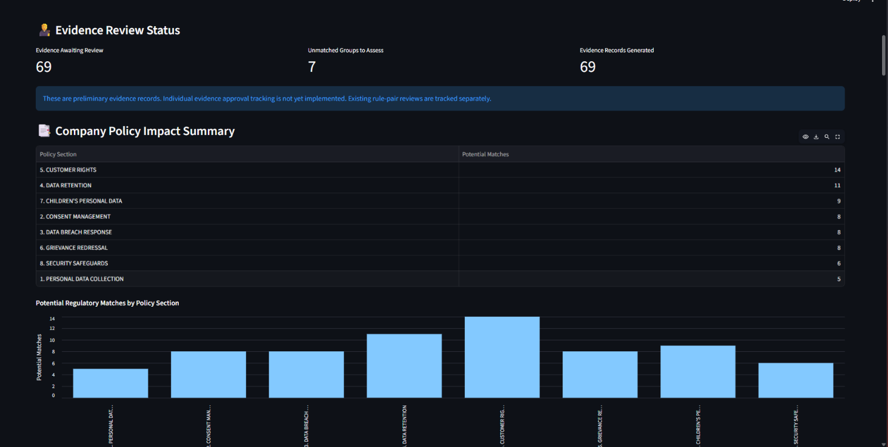
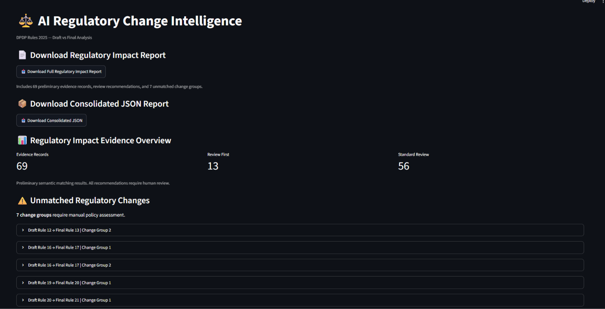
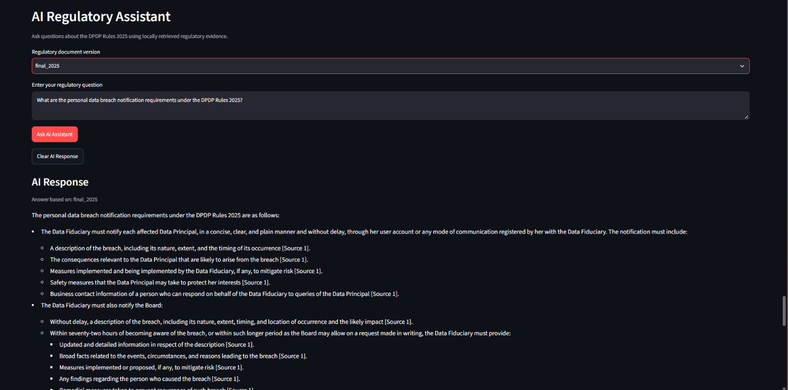
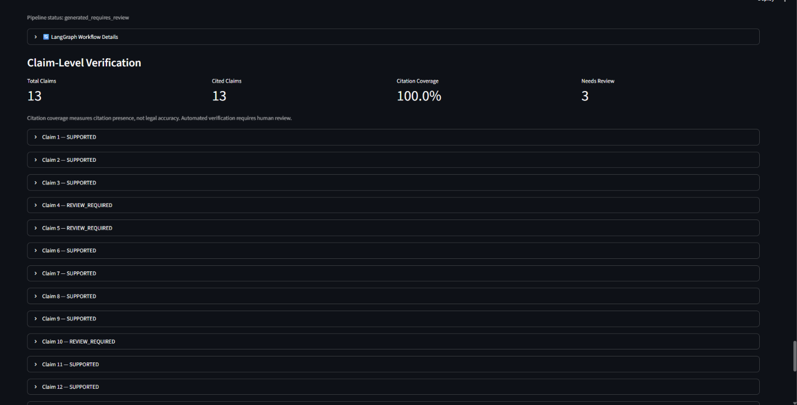
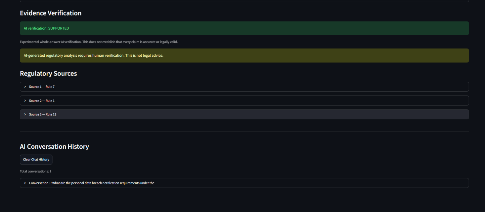
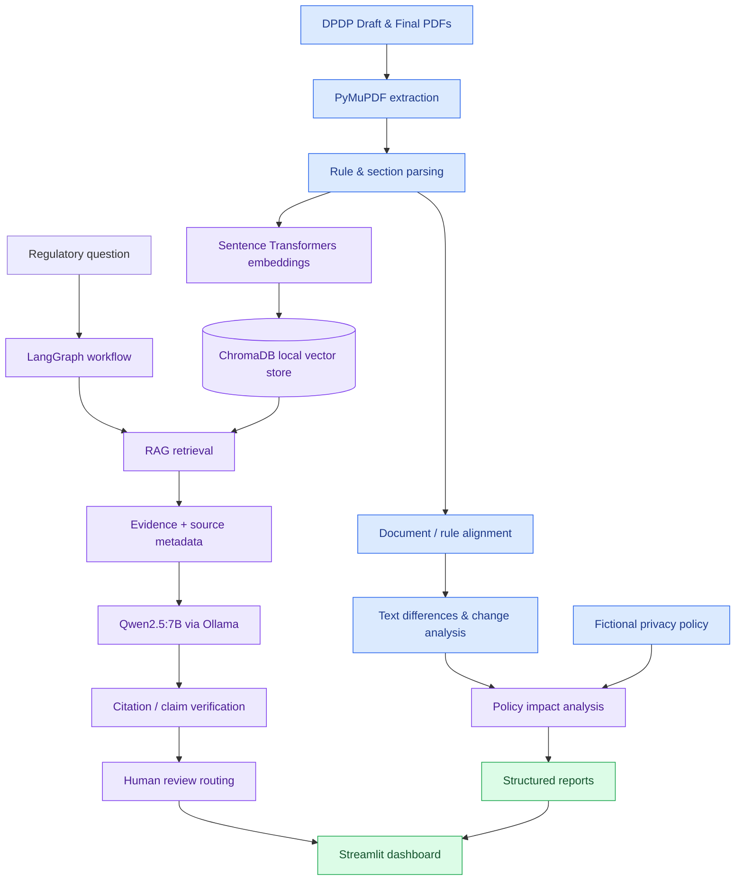

<div align="center">

# ⚖️ Regulatory AI Intelligence System

### Regulatory change detection · Evidence-grounded RAG · Local LLM · Human review

An end-to-end **AI-assisted regulatory intelligence** project that compares India's **DPDP Rules 2025** draft and final documents, retrieves source-linked regulatory evidence, and helps assess potential impacts on a **fictional organization's privacy policy**.


**[Architecture](#-system-architecture) · [Features](#-key-features) · [Quick Start](#-quick-start) · [Project Structure](#-project-structure) · [Testing](#-testing)**

</div>

---

## ✨ Project at a glance

| 📄 Document intelligence | 🧠 Retrieval & generation | 🛡️ Trust & review |
|:---|:---|:---|
| PDF text extraction, rule parsing, draft/final alignment, change analysis | `all-MiniLM-L6-v2` embeddings, persistent ChromaDB, Qwen2.5:7B via Ollama | Source citations, claim/evidence checks, prompt-injection screening, human review routing |

> **Scope:** This is an educational/portfolio system using DPDP Rules 2025 and a fictional privacy policy. Its generated findings are preliminary and require human review; they are **not legal advice**.

## 🖥️ Application preview

### Policy impact analysis



*Potential regulatory matches across sections of a fictional organization's privacy policy; findings are preliminary.*

<details>
<summary><strong>📸 Explore more application screenshots</strong></summary>

### Regulatory intelligence dashboard



### AI regulatory assistant — RAG + local LLM



### Claim-level verification



*Citation coverage measures whether citations are present, not whether the answer is legally accurate. Some claims are flagged for human review.*

### Evidence verification and regulatory sources



*Experimental verification is not a substitute for legal or expert review.*

</details>

## 🧭 System architecture



*This diagram is a conceptual overview of the repository's related processing paths, not a claim that every module runs sequentially in a single command.*

## 🚀 Key features

- **Regulatory PDF processing:** Extracts and structures text from draft and final regulatory PDFs.
- **Rule alignment and change detection:** Matches regulatory provisions and produces structured change-analysis artifacts.
- **Semantic search:** Uses local 384-dimensional `all-MiniLM-L6-v2` embeddings with persistent ChromaDB storage.
- **Evidence-grounded RAG:** Retrieves relevant provisions before generating regulatory answers.
- **Local LLM:** Connects to `qwen2.5:7b` through the local Ollama API; no paid inference API key is required.
- **LangGraph workflow:** Orchestrates question validation, RAG execution, verification assessment, and review routing.
- **Citation and claim checks:** Includes dedicated modules for citation validation, claim extraction, evidence mapping, and verification.
- **Prompt security:** Includes prompt-injection detection logic for retrieved content.
- **Policy impact analysis:** Compares regulatory changes with a fictional company policy and generates evidence-oriented reports.
- **Human-in-the-loop review:** Supports saving and viewing reviewer decisions.
- **Streamlit interface:** Presents evidence summaries, review queues, regulatory questions, and downloadable reports.

## 🧰 Technology stack

| Layer | Technologies | Role |
|---|---|---|
| Core | Python | Processing, pipelines, orchestration |
| Documents | PyMuPDF | PDF text extraction |
| Embeddings | Sentence Transformers (`all-MiniLM-L6-v2`) | Local semantic embeddings |
| Vector search | ChromaDB | Persistent local retrieval index |
| RAG | LangChain-related components, custom Python modules | Retrieval and grounded answering |
| Workflow | LangGraph | Routing and review states |
| LLM | Ollama + Qwen2.5:7B | Local text generation |
| UI | Streamlit | Dashboard and reports |
| Testing | pytest | Automated tests |

## 🗂️ Project structure

```text
Regulatory-AI-Intelligence/
├── app/
│   ├── document_engine/      # PDF extraction and section parsing
│   ├── change_engine/        # Alignment, text differences, change analysis
│   ├── impact_engine/        # Policy matching and impact evidence
│   ├── rag_engine/           # Embeddings, ChromaDB, RAG, LLM, verification
│   ├── report_engine/        # Report building
│   └── review_engine/        # Human review persistence
├── dashboard/
│   └── app.py                # Streamlit interface
├── data/
│   ├── regulatory/           # Draft and final source PDFs
│   ├── extracted/            # Extracted text JSON
│   ├── parsed/               # Parsed rule JSON
│   ├── aligned/              # Rule alignments and review queue
│   ├── analysis/             # Change analysis JSON
│   ├── company_policies/     # Fictional policy text
│   └── reports/              # Generated analysis reports
├── scripts/                  # Indexing, search, report generation, checks
├── tests/                    # Module and integration tests
├── requirements.txt
└── README.md
```

## ⚡ Quick start

**Prerequisites:** Python 3.11, Git, and [Ollama](https://ollama.com/) installed locally. Model download and the first embedding run require network access; subsequent inference is local when the models are available.

```powershell
# Clone the repository
git clone https://github.com/ameerykb/Regulatory-AI-Intelligence.git
cd Regulatory-AI-Intelligence

# Create and activate a virtual environment (Windows PowerShell)
py -3.11 -m venv .venv
.\.venv\Scripts\Activate.ps1

# Install dependencies
python -m pip install -r requirements.txt

# Download the local generation model
ollama pull qwen2.5:7b
```

Start the Ollama service if it is not already running, then index the provided parsed rules:

```powershell
python -m scripts.index_dpdp_rules
python -m scripts.search_dpdp_rules
```

Launch the dashboard from the repository root:

```powershell
streamlit run dashboard/app.py
```

> **Dependency note:** The supplied `requirements.txt` is a full environment freeze, not a minimal curated dependency list. Some pinned packages may be platform-specific; installation has not been independently verified in a clean environment for this README.

## 📊 Generated outputs

The uploaded repository includes example JSON/Markdown outputs in `data/reports/`, including:

- `dpdp_2025_policy_impact_report.json`
- `dpdp_2025_impact_evidence_report.json`
- `dpdp_2025_evidence_report.json`
- `dpdp_2025_consolidated_report.json`
- `dpdp_2025_readable_report.md`

These are generated analysis artifacts; review their evidence and limitations before interpreting any compliance recommendation.

## 🧪 Testing

The repository contains automated tests for document extraction, parsing, alignment, change analysis, embeddings, vector search, RAG, claim verification, and report building.

```powershell
python -m pytest tests/ -q
```

A test suite and test runner are included, but this README does **not** claim a fresh pass count or coverage percentage: those must be verified in the intended local environment with the required dependencies and services available.

## 🔐 Reliability & responsible use

- **Evidence-first generation:** Retrieved regulatory passages and source metadata are used to support generated answers.
- **Citation checks:** Dedicated validators assess references and supporting evidence.
- **Prompt-injection checks:** Retrieved text is screened for suspicious instructions.
- **Human oversight:** The workflow can require human review even when automated verification checks pass.
- **Local inference:** The LLM API is configured to run on `localhost` through Ollama.

These controls reduce risk but do not guarantee factual correctness, legal accuracy, or complete protection against malicious inputs.

## 🛣️ Next improvements

- [ ] Add genuine dashboard screenshots and a short demonstration GIF.
- [ ] Run and publish reproducible test results from a clean environment.
- [ ] Curate a minimal, platform-tested dependency file.
- [ ] Add retrieval and citation evaluation benchmarks with documented datasets.
- [ ] Improve deployment and setup documentation.

## 👤 Author

**Ameer Yakoob M T**  
AI & Data Science graduate · Python · Machine Learning · RAG · LLM Applications

[](https://github.com/ameerykb)
[](https://ameeryakoob.netlify.app/)

---

<div align="center"><sub>Built as an educational AI engineering project. Regulatory assessments require qualified human review.</sub></div>
